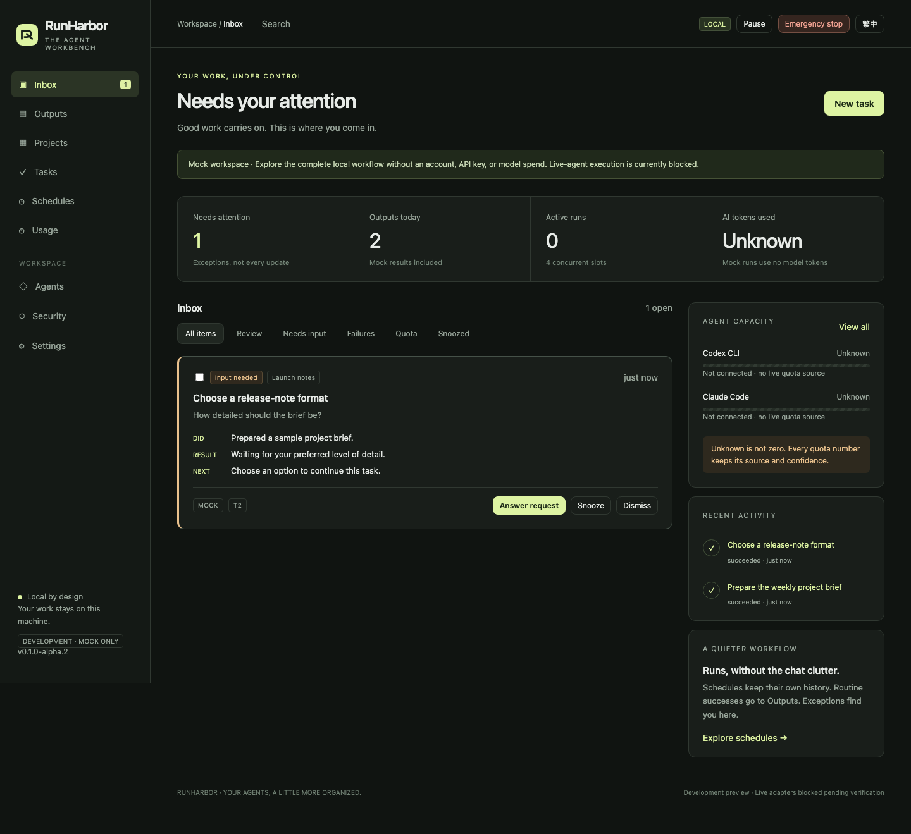
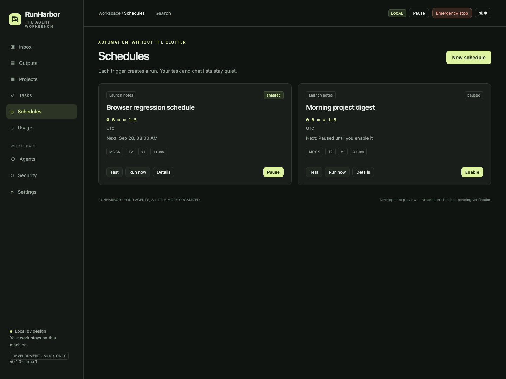
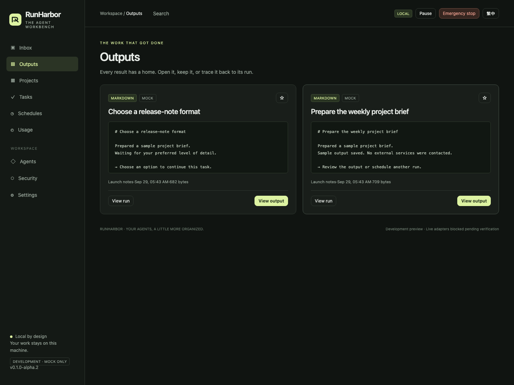

<p align="center"></p>

<h1 align="center">RunHarbor</h1>

<p align="center"><strong>Scheduled agents. Organized results. An inbox for what needs you.</strong></p>

<p align="center">A local workbench for recurring agent work — without another wall of chats.</p>

<p align="center">
  <a href="https://github.com/michaelmeicp/runharbor/actions/workflows/ci.yml"></a>
  <a href="https://github.com/michaelmeicp/runharbor/releases"></a>
  
  <a href="LICENSE"></a>
</p>

<p align="center"><a href="README.zh-Hant.md">繁體中文</a> · <a href="#try-the-demo-in-two-minutes">Quick start</a> · <a href="#status-what-works-and-what-does-not">Status</a> · <a href="#roadmap-to-real-agents">Roadmap</a> · <a href="docs/implementation-status.md">Implementation status</a> · <a href="CONTRIBUTING.md">Contribute</a></p>

> [!IMPORTANT]
> **Early alpha (v0.1.0-alpha.2), mock-only.** RunHarbor does **not** run Codex, Claude, or any other agent to do work. It does not read provider credentials and does not call a model. Every result in the demo comes from a scripted mock agent and is labeled **Mock**. Real-agent execution is not available; it stays disabled until sandbox and credential-isolation checks pass. The [v1 release gate](docs/release-gate.md) is **BLOCKED**. Use this preview to try the workflow, not to run real agent work.
>
> RunHarbor is independent of all model vendors. It does not provide, resell, or broker model access. Any future live subscription automation would require reviewing that provider's current terms first.



## The problem

Chat-style agent tools work well for one conversation. They get messy when you run **several agents on a schedule**: every recurring or parallel run becomes another thread, and the one run that failed or needs an answer is buried among the ones that succeeded.

RunHarbor is a local workbench with a different shape:

```text
Project
 └─ Task  ── what should happen
     └─ Schedule (five-field cron + IANA timezone)
         └─ Run, Run, Run …  ── each run's record stays under its schedule
             └─ three-line summary and a permanent Markdown output

Inbox  ←  only exceptions: failures, questions for you, quota warnings, delivery approvals
```

- **Work** (projects, tasks, schedules) describes what should happen.
- **Results** (runs, three-line summaries, outputs) show what did happen, and stay with that schedule.
- **Decisions** (the inbox) contain only what needs you.

This invariant is tested: ten scheduled occurrences produce ten run records and **zero new tasks or threads**. A run that needs human input can explicitly escalate into a task.

## Try the demo in two minutes

Requires **Node.js 24.13+** and npm. CI runs on macOS and Ubuntu. Windows via WSL is a target, not yet verified.

```sh
git clone https://github.com/michaelmeicp/runharbor.git
cd runharbor
npm ci --ignore-scripts
npm start
```

Open **http://127.0.0.1:4317**, copy the one-time setup code from your terminal, choose a password (12+ characters), then select **Try the demo**.

The demo needs **no API keys, model tokens, or external services**. It creates a sample project, a successful output, an input request, and a paused weekday schedule (`0 8 * * 1-5`, created paused). It is scripted. It does not interpret your prompt the way a model would.

Then try the tour:

1. Answer the input request. The next run stays in the same task.
2. Open **Outputs** and download the Markdown brief.
3. Open **Schedules**, inspect the next five triggers, run a test, and enable the schedule when you are ready.
4. In a project, enable mock fallback. In **Usage**, choose **Simulate exhausted** on the primary mock quota, run a task, and inspect the new backup run.
5. Use **Emergency stop** to cancel work and pause dispatch, then resume explicitly.

Routine success stays in Outputs. Failures and questions come back to the inbox.





<details>
<summary>Data location, CLI, and the prerelease archive</summary>

Data is stored in `~/.runharbor` by default. Set `RUNHARBOR_DATA_DIR` or pass `--data-dir` to choose another directory. Nothing in that directory is sent to a hosted service.

`npm ci` installs the pinned production dependency, [Croner](https://github.com/Hexagon/croner) 10.0.1, and the development tools used by the tests. A production install of the prerelease archive installs Croner only.

```sh
node src/cli.js start --port 4318 --data-dir ./data
node src/cli.js doctor
node src/cli.js stop-all
```

`doctor` prints local facts. If `codex` or `claude` is on your `PATH`, it runs that program with `--version` only. It does not start a task, read provider credentials, or call a model. The report's execution mode is `mock-only`.

Use the same data directory for `stop-all` as the running service. `stop-all` writes a sentinel the running process checks; it does not kill an unrelated process. After a hard crash, verify the old process is gone before removing a stale `service.lock`.

**No npm-registry package or container image has been published.** The package name in this repository is `@michaelmeicp/runharbor`. Do not assume an unscoped `npx runharbor` package belongs to this project.

The [v0.1.0-alpha.2 prerelease](https://github.com/michaelmeicp/runharbor/releases/tag/v0.1.0-alpha.2) publishes `michaelmeicp-runharbor-0.1.0-alpha.2.tgz` and `SHA256SUMS`. No signature or attestation file is attached. The source checkout above is the current install path.

</details>

## Status: what works and what does not

| Area | In the alpha today (mock agent only) |
| --- | --- |
| Project → task → run → output | Works with the scripted mock agent |
| Exception inbox | Deduplication, severity, snooze, dismiss, resolve, batch undo |
| Scheduling | Five-field cron, IANA timezones, next-five preview, bounded catch-up, retry, queue/skip/parallel policies |
| Human input | Mock question → answer → continued task; schedule escalation into a task |
| Outputs | Permanent Markdown files, inert preview, download, stars, workspace-independent retention |
| Memory | Human-authored project notes, bounded taint-aware context injection |
| Quota / fallback | Synthetic quota scenarios; unknown values stay unknown, never 0; new-run mock fallback keeps the source permissions |
| Local delivery | Fixed folder, per-output hash-bound approval, idempotent filename |
| Safety controls | Login, Host/Origin/CSRF checks, authenticated SSE, no HTML execution, redaction, audit hash chain, emergency stop |
| Search | SQLite FTS5, with a substring fallback for queries shorter than three characters (including short CJK) |

**Not ready:** live Codex/Claude execution, verified OS sandboxing, keyring and environment isolation, live quota sources, safe git worktrees and merges, RRULE, full failback and circuit behavior, encrypted backup/export, complete permanent deletion, plugin loading, full localization, signed or attested npm/container distribution, the seven-day M0 alternative evaluation, and verified live CLI fixtures. The [implementation matrix](docs/implementation-status.md) tracks every requirement. The [M0 record](docs/M0-verification.md) separates observations from assumptions. A passing test count is not a completion percentage and does not mean production readiness.

Codex and Claude appear in the UI as disconnected profiles. They are disabled, and this build refuses to execute anything that is not the mock agent.

### Why real agents are still off

Parsing an agent CLI's output is not the same as proving the agent cannot read or write outside its workspace. Recorded **synthetic** macOS filesystem probes reproduced reads outside the intended boundary (`fixtures/m0/codex-0.157.0-macos-filesystem.json`). Real spawning stays disabled until per-version sandbox and credential boundaries pass ([backlog](docs/prioritized-backlog.md), items 10–13). Blocking a risky feature is safe behavior for this preview. It is not the same as finishing the feature.

## Roadmap to real agents

The list below is a reader-facing condensation of the **remaining** work in [docs/prioritized-backlog.md](docs/prioritized-backlog.md), in that file's order. It is not a copy of every numbered row. Items 1–9 are already recorded as done or implemented there. Richer YAML mock scripts (15) and pipelines (22) are still open and are not separate steps here.

1. Sandbox evidence on macOS and Linux (filesystem and network) and redacted **real** CLI output fixtures (items 10–12).
2. A first real adapter, behind an explicit opt-in, only after those boundary checks pass (item 13).
3. Live session resume for input requests. Mock question-and-answer continuation is not that (item 14).
4. Managed git worktrees, pre-commit secret scanning, diff review, and bound merge approvals (items 16–19).
5. OS keyring and subprocess credential isolation (item 20).
6. RRULE and Chinese trigger display, encrypted export/backup, and an adapter plugin loader (items 21, 23, and 24).
7. v1 only when all 19 baseline gates in [release-gate.md](docs/release-gate.md) pass (item 26).

No dates are promised.

## How it is built

- Plain **Node.js 24 ESM** JavaScript (`engines.node` is `>=24.13.0`). No application build step.
- Server: `node:http` and **`node:sqlite`** (FTS5). Browser: native DOM APIs, no framework.
- **One production dependency:** [Croner](https://github.com/Hexagon/croner) 10.0.1, pinned in the lockfile.
- Binds to `127.0.0.1` only, password login, CSRF/Host/Origin checks, and an append-only audit hash chain.
- 45 unit and integration tests in `tests/` (`npm test`). CI runs `npm run verify` on macOS and Ubuntu with Node 24. The Chromium browser suite runs on Ubuntu and covers first-run setup, the demo, input continuation, output preview, schedule creation/test/enable, inert hostile output, eight mobile routes, and emergency stop.

See [architecture](docs/architecture.md) and the [draft adapter contract](packages/adapter-sdk/index.d.ts). Dynamic plugin loading is not implemented.

```sh
npm ci --ignore-scripts
npm run verify
npx playwright install chromium
npm run test:browser
```

## Help wanted

The most valuable contributions right now are **evidence**, not features:

- Sandbox probes for macOS and Linux, and redacted real agent-CLI output fixtures
- Scheduler edge cases with a deterministic clock (DST, catch-up, retries)
- Accessibility: keyboard and screen-reader coverage
- Completing the Traditional Chinese (`zh-Hant`) UI translation
- Clean-machine install notes, including Windows via WSL, which CI does not cover

Look for issues labeled [`good first issue`](https://github.com/michaelmeicp/runharbor/labels/good%20first%20issue) and read [CONTRIBUTING](CONTRIBUTING.md). Report vulnerabilities via [SECURITY.md](SECURITY.md), not public issues.

If this workflow would make your agent work easier to manage, a star helps others find it. A reproducible issue helps make it reliable.

## FAQ

**Does it run Claude Code or Codex today?** No. Those profiles are disabled. Adapter code is proposed permission policy and synthetic parsers only. Live execution is disabled, and a non-mock profile fails closed.

**Does it need an API key?** Not for the demo. RunHarbor does not provide, resell, or broker model access.

**Is my data sent anywhere?** No hosted service stores your projects, runs, or outputs. Data stays in your data directory. Installing dependencies with npm contacts the npm registry.

**Can I install it with npm?** Not from the registry. Use the source checkout or the prerelease `.tgz` named above.

## 繁體中文簡介

RunHarbor 是本機優先的排程代理工作台。多個代理加上排程時，聊天式工具的歷史會變亂；這裡用專案、任務與排程管理要做的事，每次排程執行的紀錄留在該排程底下，收件匣只放失敗、待你回答的問題、額度警示與待批准的投遞。

**目前是早期 alpha（v0.1.0-alpha.2），只支援 Mock Agent。** 不會用 Codex／Claude 執行工作、不讀取憑證、不呼叫模型。真實代理執行尚未提供，須等沙箱與憑證隔離驗證通過，[v1 發佈閘門](docs/release-gate.md)仍為 **BLOCKED**。繁體中文說明見 [README.zh-Hant.md](README.zh-Hant.md)。

## License and attribution

[Apache-2.0](LICENSE). This implementation does not copy Orca code. Third-party names describe planned interoperability and do not imply affiliation, endorsement, or shared licensing.
